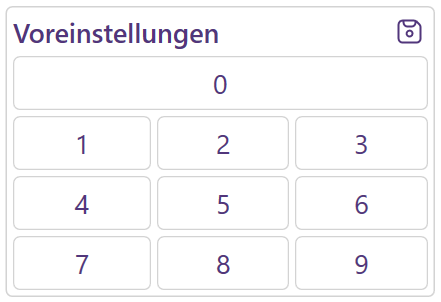
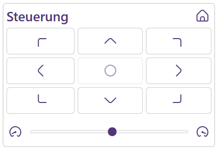
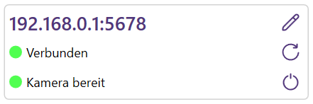

# 

ViscaCamLink ist eine Kamerasteuerung für [PTZ-Kameras](https://de.m.wikipedia.org/wiki/PTZ-Kamera), die über eine Netzwerkverbindung mit dem VISCA Protokoll (VISCA over IP) ansprechbar sind.

🇬🇧 | 🇺🇸 – [Read in English](README.md)

## Funktionen

### Voreinstellungen

* Speichern und Abrufen von Kamerapositionen (inklusive Zoom) als Voreinstellung
* Numpad-Anordnung (Standard) oder normale Anordnung, auswählbar in den Einstellungen
* Optionale Gruppen mit je 10 Voreinstellungen, insgesamt bis zu 256 Kamera-Speicherplätze
* Umbenennen einer Voreinstellung oder Gruppe per Doppelklick auf den Namen (Enter bestätigt, Escape bricht ab)

 

<!-- TODO screenshot: Assets/presets-de.png durch das Voreinstellungspanel mit Gruppen-Tabs und benannten Voreinstellungen ersetzen -->

### Steuerung

* Freies Bewegen in jede Richtung über die Pfeil-Schalter
* Schwenken/Neigen mit der Maus: auf dem mittleren Schalter klicken und ziehen; je weiter der Mauszeiger von der Mitte entfernt ist, desto schneller bewegt sich die Kamera
* 24-stufige Anpassung der Bewegungsgeschwindigkeit
* Zurücksetzen in Ausgangsposition

 

### Zoom

* Freies Herein- und Herauszoomen
* 7-stufige Anpassung der Zoom-Geschwindigkeit

 

### Tastenbelegung (Hotkeys)

* Alle Hotkeys sind unter Einstellungen → Hotkeys anpassbar: eine Aktion anklicken und die neue Taste drücken (Escape bricht ab)
* Verfügbare Aktionen: Voreinstellungen 0–9 der aktiven Gruppe, Bewegen hoch/runter/links/rechts, Zoom herein/heraus, vorheriges/nächstes Kameraprofil, vorherige/nächste Gruppe
* Standardmäßig liegen die Voreinstellungen 0–9 auf den Numpad-Tasten 0–9
* Doppelte Belegungen werden erkannt und angezeigt
* Ein Schalter für globale Hotkeys legt fest, ob Hotkeys auch funktionieren, wenn die App nicht im Vordergrund ist

<!-- TODO screenshot: Einstellungen-Dialog, Bereich Hotkeys (z. B. Assets/options-de.png) -->

### Kameraprofile

* Mehrere Kameras (Name, IP-Adresse, Port) als Profile speichern und im Hauptfenster zwischen ihnen wechseln
* Profile im Kameraprofil-Dialog verwalten (hinzufügen, bearbeiten, löschen)

<!-- TODO screenshot: Kameraprofil-Dialog (z. B. Assets/camera-profiles-de.png) -->

### Kompaktfenster

* Ist in den Einstellungen „Kompakte Ansicht beim Minimieren verwenden“ aktiviert, öffnet sich beim Minimieren ein kleines Fenster mit Voreinstellungen, Bewegung und Zoom in Tabs

<!-- TODO screenshot: Kompaktfenster (z. B. Assets/compact-de.png) -->

### Designs und Sprachen

* Helles, dunkles oder systembasiertes Design; mit „Systembasiert“ folgt die App live dem Windows-App-Modus
* Oberfläche verfügbar in Deutsch und Englisch
* Volle Unterstützung der Windows-Skalierung
* Layout und Einstellungen werden benutzerspezifisch gespeichert

### Automatische Updates

* ViscaCamLink sucht beim Start nach einer neuen Version. Ist eine verfügbar, erscheint ein Update-Schalter; der Update-Dialog zeigt die Änderungen, lädt das Update herunter und startet die App neu
* Einstellungen, Voreinstellungen und Hotkeys bleiben bei Updates erhalten

## Erster Start

`ViscaCamLink.App-win-Setup.exe` aus dem [aktuellen Release](https://github.com/misorrek/ViscaCamLink/releases/latest) herunterladen und ausführen. Die App wird für den aktuellen Benutzer installiert (keine Administratorrechte nötig) und startet automatisch. Alternativ gibt es ein portables Zip-Archiv. Die App bringt alles Nötige mit, eine separate .NET-Installation ist nicht erforderlich. Voraussetzung: Windows 10 oder 11 (x64).

Wechsel von Version 0.3.0? Die Kameraeinstellungen werden beim ersten Start automatisch übernommen, und die App bietet an, die alte Version zu deinstallieren.

## Benutzung

Nach dem ersten Start muss die IP-Adresse der Kamera und der Port für das VISCA Protokoll (wenn vom Standard abweichend) hinterlegt werden. (Wie Sie an diese Informationen herankommen, beschreibt das Benutzerhandbuch der Kamera.)

Danach kann die Verbindung über den entsprechenden Schalter in der Adresszeile aufgebaut werden. Ob dies erfolgreich war, zeigt die Status-Anzeige darunter. Ebenfalls wird angezeigt, ob die Kamera angeschaltet ist oder sich im Standby-Modus befindet. Die Verbindung wird regelmäßig geprüft: Ist die Kamera nicht mehr erreichbar, zeigt der Status dies an und erholt sich automatisch, sobald die Kamera wieder erreichbar ist.

 

## Support und Protokolle

ViscaCamLink schreibt pro Tag eine Protokolldatei nach `%LocalAppData%\ViscaCamLink.App\logs\` (14 Tage aufbewahrt). Unter Einstellungen → Support gibt es einen Schalter zum Öffnen des Protokollordners und eine Auswahl der Protokollstufe (wirkt sofort), außerdem wird die App-Version angezeigt. Bitte bei Problemmeldungen die Protokolldatei und die Version angeben.

Einstellungen, Voreinstellungen und Hotkeys liegen in `%AppData%\ViscaCamLink\`.

## Lizenz

[Apache 2.0](https://www.viscacamlink.info/en/license)

Diese Applikation basiert auf dem Demo-Quelltext "CameraControl". Für weitere Informationen siehe [Hinweise zu Drittanbieter-Software](THIRD-PARTY-NOTICES).

Icons von flaticon.com/de/uicons
