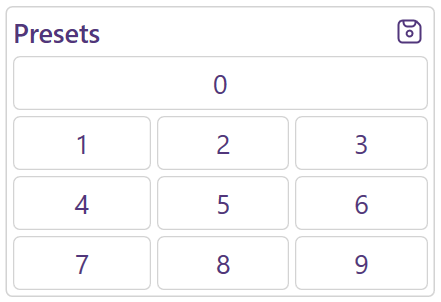
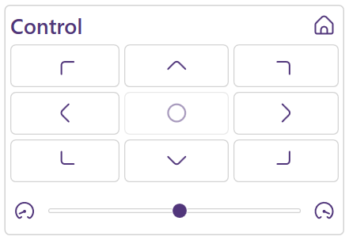
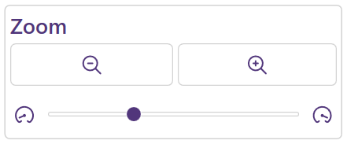
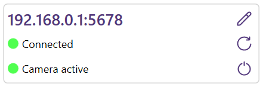

# 

ViscaCamLink is a camera controller for [PTZ cameras](https://en.wikipedia.org/wiki/Pan%E2%80%93tilt%E2%80%93zoom_camera) that can be reached via a network connection using the VISCA protocol (VISCA over IP).

🇩🇪 | 🇦🇹 | 🇨🇭 – [In Deutsch lesen](README-de.md)

## Features

### Presets

* Save and recall camera positions (including zoom) as presets
* Numpad layout (default) or standard layout, selectable in Options
* Optional preset groups of 10 presets each, up to 256 camera slots in total
* Rename a preset or a group by double-clicking its name (Enter confirms, Escape cancels)

 

<!-- TODO screenshot: replace Assets/presets.png with the preset panel showing group tabs and named presets -->

### Control

* Free movement in any direction via the arrow buttons
* Mouse pan/tilt: click and drag on the centre button; the further the cursor is from the centre, the faster the camera moves
* 24-step adjustment of movement speed
* Return to home position

 

### Zoom

* Freely zooming in and out
* 7-step adjustment of zoom speed

 

### Hotkeys

* All hotkeys can be customized in Options → Hotkeys: click an action and press the new key (Escape cancels)
* Available actions: presets 0–9 of the active group, move up/down/left/right, zoom in/out, previous/next camera profile, previous/next preset group
* By default, presets 0–9 are assigned to the numpad keys 0–9
* Conflicting assignments are detected and shown
* A global hotkeys switch decides whether hotkeys also work while the app is not focused

<!-- TODO screenshot: Options dialog, Hotkeys section (e.g. Assets/options.png) -->

### Camera profiles

* Store several cameras (name, IP address, port) as profiles and switch between them in the main window
* Manage the profiles in the camera profile dialog (add, edit, delete)

<!-- TODO screenshot: camera profile dialog (e.g. Assets/camera-profiles.png) -->

### Compact window

* With "Use compact view when minimizing" enabled in Options, minimizing the app opens a small window with presets, movement and zoom in tabs

<!-- TODO screenshot: compact window (e.g. Assets/compact.png) -->

### Themes and languages

* Light, dark or system theme; with "System based", the app follows the Windows app mode live
* Interface available in English and German
* Full Windows scaling support
* Layout and settings are saved per user

### Automatic updates

* ViscaCamLink checks for a new version on start. When one is available, an update button appears; the update dialog shows the changelog, downloads the update and restarts the app
* Settings, presets and hotkeys are kept across updates

## First start

Download `ViscaCamLink.App-win-Setup.exe` from the [latest release](https://github.com/misorrek/ViscaCamLink/releases/latest) and run it. The app is installed for the current user (no administrator rights needed) and starts automatically. A portable zip is available as well. The app is self-contained, so no separate .NET installation is needed. Requirements: Windows 10 or 11 (x64).

Coming from version 0.3.0? Your camera settings are imported automatically on the first start, and the app offers to uninstall the old version.

## Usage

After the first start, the IP address of the camera and the port for the VISCA protocol (if different from the default) must be typed in. (How to get this information is described in the user manual of the camera.)

After that, the connection can be established using the corresponding button in the address bar. Whether this was successful is shown in the status display below. It also shows if the camera is switched on or is in standby mode. The connection is checked regularly: if the camera becomes unreachable, the status shows it and recovers automatically once the camera is back.

 

## Support and logs

ViscaCamLink writes one log file per day to `%LocalAppData%\ViscaCamLink.App\logs\` (kept for 14 days). Options → Support has an "Open logs folder" button and a log level selector (applies immediately), and shows the app version. Please include the log file and the version when reporting a problem.

Settings, presets and hotkeys are stored in `%AppData%\ViscaCamLink\`.

## License

[Apache 2.0](https://www.viscacamlink.info/en/license)

This application is based on the demo code "CameraControl". For further information see the [third party notices](THIRD-PARTY-NOTICES).

Icons from flaticon.com/uicons
